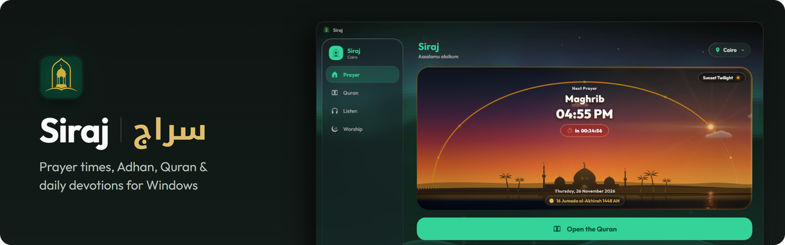
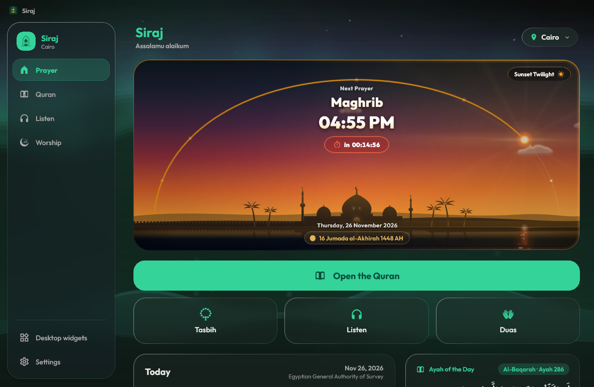
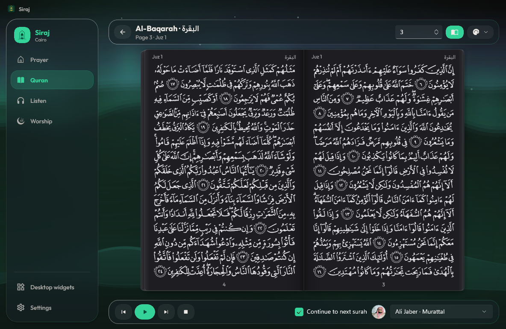

<p align="center">
  
</p>

<p align="center">
  A native Windows app for prayer times, Adhan alerts, the Madinah Mushaf, and daily devotions.
</p>

<p align="center">
  <a href="#download">Download</a> &bull;
  <a href="#features">Features</a> &bull;
  <a href="#screenshots">Screenshots</a> &bull;
  <a href="#build-from-source">Build</a>
</p>

<p align="center">
  <strong>English</strong> | <a href="docs/README-AR.md">العربية</a>
</p>

---

Siraj is a WinUI 3 desktop app for Windows 10 (1809+) and Windows 11. Prayer times, Hijri dates, and background Adhan alerts are all calculated locally on your PC with no account and no tracking. It stays light in the system tray so Adhan notifications, desktop widgets, and the taskbar prayer bar keep working even when the main window is closed.

## Features

- Prayer dashboard with a live sky card that tracks the sun, moon phase, and current prayer period, supporting standard calculation methods, Shafi/Hanafi Asr, high-latitude rules, and per-prayer minute offsets.
- Background Adhan alerts from the system tray with pre-prayer reminders, a dedicated Adhan alert window, Fajr Adhan support, and bundled plus optional full-length recordings.
- Customizable Windows taskbar prayer bar (drag anywhere across the taskbar, glass/accent/solid/text-only styles, custom colors) with an acrylic prayer schedule flyout, plus movable desktop widgets.
- Offline Madinah Mushaf reader using King Fahd Complex page fonts in single or two-page spread view, with ayah bookmarks, search, Tafsir Al-Muyassar, Khatma tracking, and verse-by-verse or full-surah recitation.
- Quran radio streams, daily Adhkar with counter, Tasbih, Hadith collections, the 99 Names of Allah, Fasting log, Zakat calculator, and regional Hijri calendar (Umm al-Qura and country-specific sighting/calculation modes).
- Twelve accent palettes, light/dark/AMOLED themes, animated backgrounds, glass UI finishes, and full localization in English, Arabic (RTL), Turkish, and Urdu.

## Screenshots

<table>
  <tr>
    <td></td>
    <td></td>
  </tr>
  <tr>
    <td align="center"><sub>Prayer dashboard &amp; sky card</sub></td>
    <td align="center"><sub>Madinah Mushaf reader</sub></td>
  </tr>
  <tr>
    <td></td>
    <td></td>
  </tr>
  <tr>
    <td align="center"><sub>Taskbar prayer bar &amp; widgets</sub></td>
    <td align="center"><sub>Appearance &amp; themes</sub></td>
  </tr>
</table>

<p align="center">
  
</p>

## Download

Grab the latest installer from [GitHub Releases](https://github.com/M-H-AFIFI/Siraj/releases/latest):

- `SirajSetup-<version>-x64.exe` for standard 64-bit Intel and AMD PCs.
- `SirajSetup-<version>-arm64.exe` for Windows on ARM devices.

Both installers are self-contained (the .NET runtime and Windows App SDK are bundled inside) and install per user under `%LOCALAPPDATA%\Programs\Siraj` without an administrator prompt. You can verify any download against the release `SHA256SUMS.txt` using `certutil -hashfile SirajSetup-1.0.0-x64.exe SHA256`.

Once installed, Siraj checks for new releases automatically (or on demand in Settings -> Updates), verifies the installer checksum, updates in place without touching your settings or downloaded Mushaf pages, and restarts into the new version.

Unattended or machine-wide install switches:

```powershell
# Silent per-user install
.\SirajSetup-1.0.0-x64.exe /VERYSILENT /NORESTART

# Install for all users (requires administrator)
.\SirajSetup-1.0.0-x64.exe /ALLUSERS
```

## Build from source

Prerequisites:

- Windows 10 (1809+) or Windows 11
- [.NET 10 SDK](https://dotnet.microsoft.com/download/dotnet/10.0)
- [Inno Setup 6.7+](https://jrsoftware.org/isinfo.php) (only needed to build `.exe` installers)

Clone and build:

```powershell
git clone https://github.com/M-H-AFIFI/Siraj.git
cd Siraj

# Run core unit tests
dotnet test tests/Siraj.Core.Tests

# Build Debug (x64)
dotnet build src/Siraj.App/Siraj.App.csproj -p:Platform=x64

# Publish Release and package x64 + ARM64 installers in out\installer
.\build.ps1

# Or package x64 only
.\build.ps1 -Arch x64
```

Developer switches:

- `SIRAJ_DATA_DIR=<folder>` isolates settings, journal, and logs into a separate folder without touching your normal profile.
- `SIRAJ_MUTE=1` mutes Adhan playback while testing.
- `--sky-time=2026-11-26T16:40:00` previews the sky card at a specific local date and time.
- `--background` starts straight into the system tray without opening the main window.

## License

Siraj is released under the [MIT License](LICENSE). Third-party libraries, fonts, and audio credits are listed in [NOTICE.txt](NOTICE.txt).
