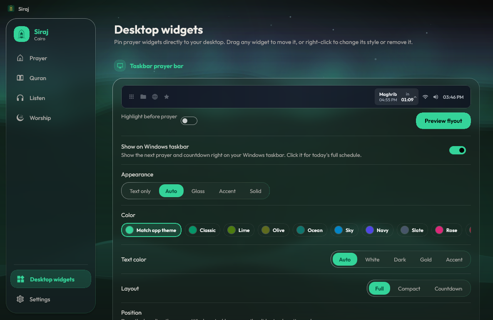
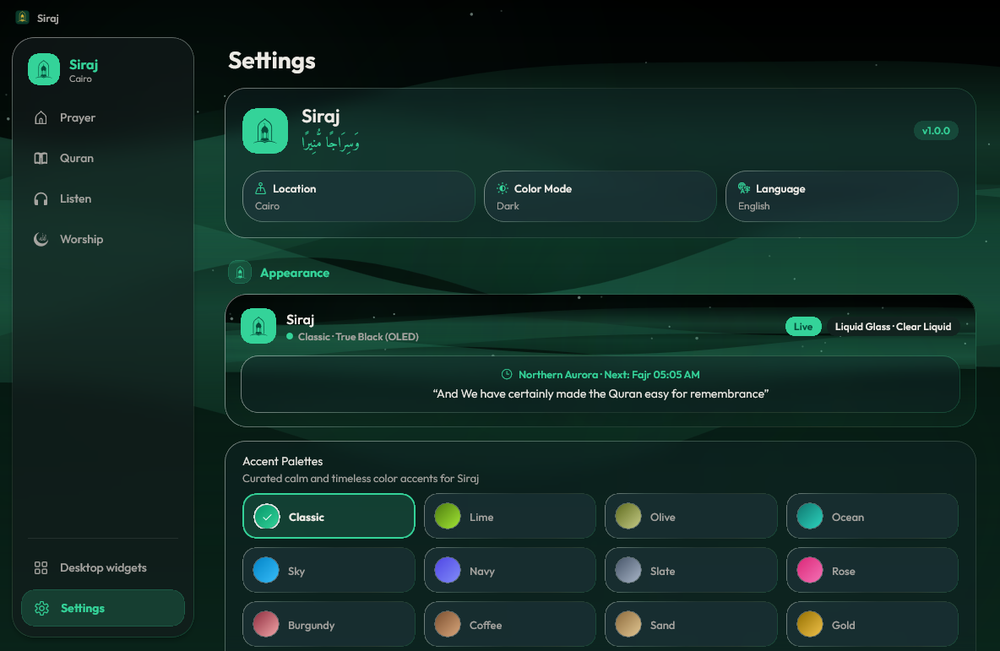
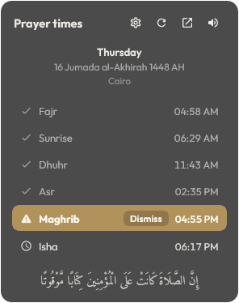

<p align="center">
  
</p>

<p align="center">
  Prayer times, Adhan alerts, and the Madinah Mushaf for Windows.
</p>

<p align="center">
  <a href="#download">Download</a> &bull;
  <a href="#features">Features</a> &bull;
  <a href="#screenshots">Screenshots</a> &bull;
  <a href="#build-from-source">Build</a>
</p>

<p align="center">
  <strong>English</strong> | <a href="docs/README-AR.md">العربية</a>
</p>

---

Siraj is a WinUI 3 app for Windows 10 (1809+) and Windows 11. Prayer times, Hijri dates, and background Adhan alerts run locally on your PC with no account and no tracking. Closing the window leaves it in the system tray so Adhan alerts, desktop widgets, and the taskbar prayer bar keep running.

## Features

- Prayer dashboard with a live sky card, standard calculation methods, Shafi/Hanafi Asr, and minute offsets.
- Background Adhan alerts from the system tray with pre-prayer reminders, Fajr Adhan support, and optional full-length recordings.
- Movable Windows taskbar prayer bar with a schedule flyout, plus pinned desktop widgets.
- Offline Madinah Mushaf reader in single or two-page spread view with search, bookmarks, Tafsir Al-Muyassar, and Khatma tracking.
- Verse-by-verse and full-surah Quran recitation alongside live Quran radio streams.
- Daily Adhkar with progress tracking, Tasbih, Hadith collections, the 99 Names of Allah, Fasting log, and Zakat calculator.
- Regional Hijri calendar supporting Umm al-Qura and country-specific sighting modes.
- Light, dark, and AMOLED themes with 12 accent palettes, optional live backgrounds, and English, Arabic (RTL), Turkish, and Urdu UI.

## Screenshots

<table>
  <tr>
    <td></td>
    <td></td>
  </tr>
  <tr>
    <td align="center"><sub>Prayer dashboard &amp; sky card</sub></td>
    <td align="center"><sub>Madinah Mushaf reader</sub></td>
  </tr>
  <tr>
    <td></td>
    <td></td>
  </tr>
  <tr>
    <td align="center"><sub>Taskbar prayer bar &amp; widgets</sub></td>
    <td align="center"><sub>Appearance &amp; themes</sub></td>
  </tr>
</table>

<p align="center">
  
</p>

## Download

Grab the latest installer from [GitHub Releases](https://github.com/M-H-AFIFI/Siraj/releases/latest):

- `SirajSetup-<version>-x64.exe` for standard 64-bit Intel and AMD PCs.
- `SirajSetup-<version>-arm64.exe` for Windows on ARM devices.

Both installers bundle the .NET runtime and Windows App SDK, and install per user under `%LOCALAPPDATA%\Programs\Siraj` without an administrator prompt. You can check any download against `SHA256SUMS.txt` using `certutil -hashfile SirajSetup-<version>-x64.exe SHA256`.

Siraj checks for updates automatically (or anytime in Settings -> Updates), verifies the installer checksum, and updates in place without touching your settings or downloaded Mushaf pages.

Unattended or machine-wide install switches:

```powershell
# Silent per-user install
.\SirajSetup-<version>-x64.exe /VERYSILENT /NORESTART

# Install for all users (requires administrator)
.\SirajSetup-<version>-x64.exe /ALLUSERS
```

## Build from source

Prerequisites:

- Windows 10 (1809+) or Windows 11
- [.NET 10 SDK](https://dotnet.microsoft.com/download/dotnet/10.0)
- [Inno Setup 6.7+](https://jrsoftware.org/isinfo.php) (only needed to build `.exe` installers)

Clone and build:

```powershell
git clone https://github.com/M-H-AFIFI/Siraj.git
cd Siraj

# Run core unit tests
dotnet test tests/Siraj.Core.Tests

# Build Debug (x64)
dotnet build src/Siraj.App/Siraj.App.csproj -p:Platform=x64

# Publish Release and package x64 + ARM64 installers in out\installer
.\build.ps1

# Or package x64 only
.\build.ps1 -Arch x64
```

## License

Siraj is released under the [MIT License](LICENSE). Third-party libraries, fonts, and audio credits are listed in [NOTICE.txt](NOTICE.txt).
