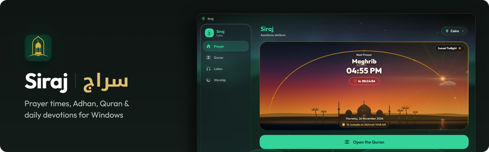
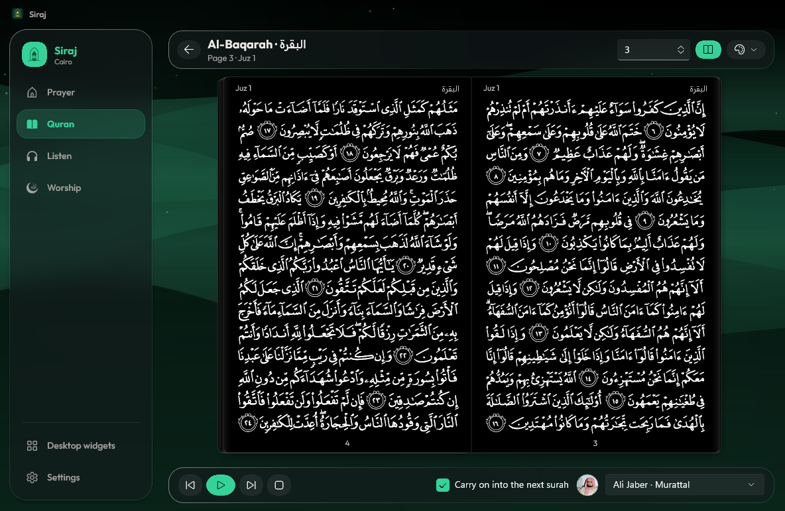
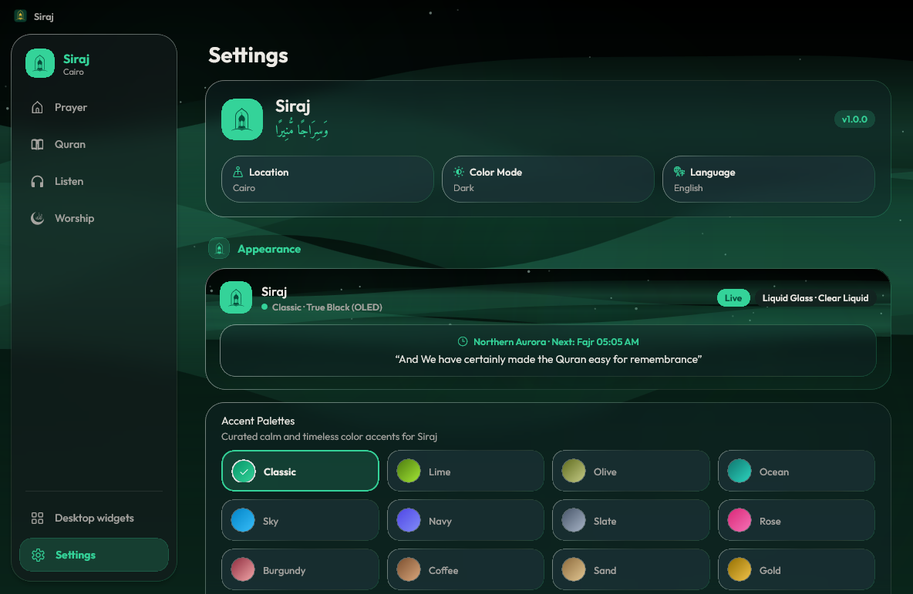
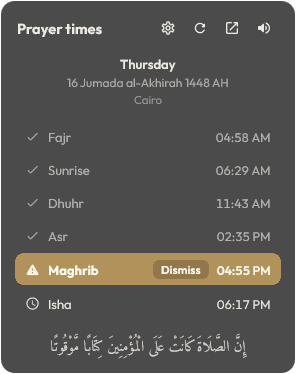

<div dir="rtl">

<p align="center">
  
</p>

<p align="center">
  مواقيت الصلاة والأذان ومصحف المدينة لويندوز.
</p>

<p align="center">
  <a href="#التحميل">التحميل</a> &bull;
  <a href="#المميزات">المميزات</a> &bull;
  <a href="#لقطات-الشاشة">لقطات الشاشة</a> &bull;
  <a href="#البناء-من-المصدر">البناء من المصدر</a>
</p>

<p align="center">
  <a href="../README.md">English</a> | <strong>العربية</strong>
</p>

---

سراج تطبيق لويندوز 10 (إصدار 1809 وأحدث) وويندوز 11. يحسب مواقيت الصلاة والتاريخ الهجري ويشغّل الأذان مباشرة على جهازك بدون حساب وبدون تتبع. وعند إغلاق النافذة يبقى خفيفًا في الخلفية بجانب الساعة، فيرفع الأذان وتظل أدوات سطح المكتب وشريط المهام تعمل بشكل طبيعي.

## المميزات

- مواقيت الصلاة مع بطاقة سماء تتغيّر حسب وقت اليوم، وطرق الحساب المعروفة، ومذهب الشافعي والحنفي للعصر، وتعديل الدقائق لكل صلاة.
- أذان تلقائي في الخلفية مع تذكير قبل الصلاة وأذان خاص للفجر، ومؤذنين مدمجين مع إمكانية تنزيل تسجيلات كاملة.
- شريط لمواقيت الصلاة على شريط مهام ويندوز مع قائمة سريعة بمواقيت اليوم، وأدوات قابلة للتثبيت على سطح المكتب.
- قارئ لمصحف المدينة بدون إنترنت بصفحة واحدة أو صفحتين، مع البحث وحفظ المواضع والتفسير الميسر ومتابعة الختمة.
- سماع تلاوات القرآن الكريم آية بآية أو سورة كاملة، إلى جانب إذاعات القرآن المباشرة.
- أذكار اليوم مع عدّاد، وسبحة، وأحاديث نبوية، وأسماء الله الحسنى، وسجل للصيام، وحاسبة للزكاة.
- تقويم هجري يدعم تقويم أم القرى والتقويم المعتمد حسب بلدك.
- الوضع الفاتح والداكن والأسود الكامل مع 12 لونًا وخلفيات متحركة اختيارية، بواجهة عربية وإنجليزية وتركية وأردية.

## لقطات الشاشة

<table>
  <tr>
    <td></td>
    <td></td>
  </tr>
  <tr>
    <td align="center"><sub>مواقيت الصلاة وبطاقة السماء</sub></td>
    <td align="center"><sub>مصحف المدينة</sub></td>
  </tr>
  <tr>
    <td></td>
    <td></td>
  </tr>
  <tr>
    <td align="center"><sub>شريط المهام وأدوات سطح المكتب</sub></td>
    <td align="center"><sub>الألوان والمظهر</sub></td>
  </tr>
</table>

<p align="center">
  
</p>

## التحميل

حمّل أحدث نسخة من [صفحة الإصدارات على GitHub](https://github.com/M-H-AFIFI/Siraj/releases/latest):

- `SirajSetup-<version>-x64.exe` لمعظم أجهزة ويندوز (Intel وAMD).
- `SirajSetup-<version>-arm64.exe` لأجهزة ويندوز بمعالجات ARM.

لا تحتاج لتثبيت .NET أو أي ملفات إضافية، فكل ما يحتاجه التطبيق موجود داخل المثبّت. يُثبّت سراج في `%LOCALAPPDATA%\Programs\Siraj` بدون طلب صلاحيات المسؤول، ويمكنك التأكد من سلامة الملف بمقارنة SHA-256 مع ملف `SHA256SUMS.txt` عبر الأمر `certutil -hashfile SirajSetup-<version>-x64.exe SHA256`.

بعد التثبيت، يبحث سراج عن التحديثات الجديدة تلقائيًا (أو يدويًا من الإعدادات -> التحديثات)، ويتحقق من الملف قبل تثبيته ويحدّث نفسه بدون أن يمس إعداداتك أو صفحات المصحف المحفوظة.

## البناء من المصدر

تحتاج إلى:

- ويندوز 10 (1809 وأحدث) أو ويندوز 11
- [.NET 10 SDK](https://dotnet.microsoft.com/download/dotnet/10.0)
- [Inno Setup 6.7+](https://jrsoftware.org/isinfo.php) (فقط إذا أردت بناء ملفات التثبيت `.exe`)

```powershell
git clone https://github.com/M-H-AFIFI/Siraj.git
cd Siraj

# تشغيل الاختبارات
dotnet test tests/Siraj.Core.Tests

# بناء نسخة التطوير (x64)
dotnet build src/Siraj.App/Siraj.App.csproj -p:Platform=x64

# بناء ملفات التثبيت x64 و ARM64 داخل out\installer
.\build.ps1

# أو بناء x64 فقط
.\build.ps1 -Arch x64
```

## الرخصة

سراج منشور تحت [رخصة MIT](../LICENSE). حقوق المكتبات والخطوط والتسجيلات المستخدمة موجودة في [NOTICE.txt](../NOTICE.txt).

</div>
