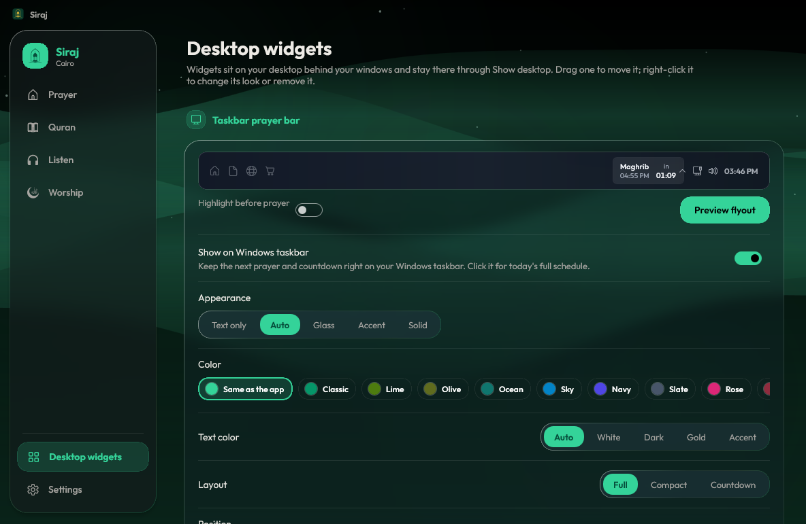

<div dir="rtl">

<p align="center">
  
</p>

<p align="center">
  تطبيق ويندوز أصلي لمواقيت الصلاة، الأذان، مصحف المدينة، والأذكار اليومية.
</p>

<p align="center">
  <a href="#التحميل">التحميل</a> &bull;
  <a href="#المزايا">المزايا</a> &bull;
  <a href="#لقطات-الشاشة">لقطات الشاشة</a> &bull;
  <a href="#البناء-من-المصدر">البناء من المصدر</a>
</p>

<p align="center">
  <a href="../README.md">English</a> | <strong>العربية</strong>
</p>

---

سراج تطبيق مكتبي لنظام ويندوز 10 (إصدار 1809 فأحدث) وويندوز 11 مبني بواجهة WinUI 3. تُحسب مواقيت الصلاة والتاريخ الهجري وتنبيهات الأذان محليًا على جهازك دون حساب ودون تتبع. يبقى التطبيق خفيفًا في منطقة الإشعارات ليُرفع الأذان وتعمل أدوات سطح المكتب وشريط المهام حتى بعد إغلاق النافذة الرئيسية.

## المزايا

- لوحة صلاة مع بطاقة سماء حيّة تتابع موقع الشمس وأطوار القمر وفترة الصلاة الحالية، مع دعم طرق الحساب المعروفة، ومذهب الشافعي والحنفي للعصر، وقواعد خطوط العرض العالية، وتعديل الدقائق لكل صلاة.
- تنبيهات أذان في الخلفية من منطقة الإشعارات، وتذكير قبل الصلاة، ونافذة أذان مخصصة، ودعم أذان الفجر، مع تسجيلات مدمجة وإمكانية تنزيل تلاوات أذان أوضح.
- أداة شريط مهام ويندوز قابلة للتخصيص الكامل (سحب حر على طول شريط المهام، مظهر زجاجي أو ملون أو معتم أو نص فقط) مع قائمة منبثقة لمواقيت اليوم، بالإضافة إلى أدوات سطح مكتب متحركة.
- قارئ مصحف المدينة دون إنترنت بخطوط مجمع الملك فهد بصفحة واحدة أو صفحتين متقابلتين، مع العلامات المرجعية، والبحث، والتفسير الميسر، ومتابعة الختمة، وتلاوة الآيات والسور.
- إذاعات القرآن الكريم، والأذكار اليومية مع عدّاد، والسبحة، ومجموعات الحديث، وأسماء الله الحسنى، وسجل الصيام، وحاسبة الزكاة، والتقويم الهجري (أم القرى والتقويم التلقائي حسب البلد).
- اثنا عشر طقمًا لونيًا، والوضع الفاتح والداكن والأسود الكامل، والخلفيات الحيّة، والواجهات الزجاجية، مع دعم كامل للعربية والإنجليزية والتركية والأردية.

## لقطات الشاشة

<table>
  <tr>
    <td></td>
    <td></td>
  </tr>
  <tr>
    <td align="center"><sub>لوحة الصلاة وبطاقة السماء</sub></td>
    <td align="center"><sub>قارئ مصحف المدينة</sub></td>
  </tr>
  <tr>
    <td></td>
    <td></td>
  </tr>
  <tr>
    <td align="center"><sub>أداة شريط المهام والأدوات</sub></td>
    <td align="center"><sub>المظهر والألوان</sub></td>
  </tr>
</table>

<p align="center">
  
</p>

## التحميل

حمّل أحدث نسخة تثبيت من [صفحة الإصدارات على GitHub](https://github.com/M-H-AFIFI/Siraj/releases/latest):

- `SirajSetup-<version>-x64.exe` لمعظم أجهزة ويندوز 64-بت (Intel وAMD).
- `SirajSetup-<version>-arm64.exe` لأجهزة ويندوز العاملة بمعالجات ARM.

ملف التثبيت مستقل بالكامل (يتضمن بيئة .NET وWindows App SDK داخله) ويُثبّت للمستخدم الحالي في `%LOCALAPPDATA%\Programs\Siraj` دون طلب صلاحيات المسؤول. يمكنك التحقق من سلامة الملف عبر بصمة SHA-256 المنشورة في `SHA256SUMS.txt` بالأمر `certutil -hashfile SirajSetup-1.0.0-x64.exe SHA256`.

بعد التثبيت، يتحقق سراج تلقائيًا من التحديثات الجديدة (أو يدويًا من الإعدادات -> التحديثات)، ويتحقق من بصمة الملف، ويُحدّث التطبيق مباشرة دون المساس بإعداداتك أو صفحات المصحف المنزّلة، ثم يعيد فتحه تلقائيًا.

## البناء من المصدر

المتطلبات:

- ويندوز 10 (1809 فأحدث) أو ويندوز 11
- [.NET 10 SDK](https://dotnet.microsoft.com/download/dotnet/10.0)
- [Inno Setup 6.7+](https://jrsoftware.org/isinfo.php) (مطلوب فقط لبناء ملفات التثبيت `.exe`)

```powershell
git clone https://github.com/M-H-AFIFI/Siraj.git
cd Siraj

# تشغيل اختبارات النواة
dotnet test tests/Siraj.Core.Tests

# بناء نسخة التطوير (x64)
dotnet build src/Siraj.App/Siraj.App.csproj -p:Platform=x64

# بناء ملفات التثبيت x64 و ARM64 داخل out\installer
.\build.ps1

# أو بناء x64 فقط
.\build.ps1 -Arch x64
```

## الرخصة

يندرج سراج تحت [رخصة MIT](../LICENSE). راجع [NOTICE.txt](../NOTICE.txt) للاطلاع على حقوق المكتبات والخطوط والتسجيلات المستخدمة.

</div>
